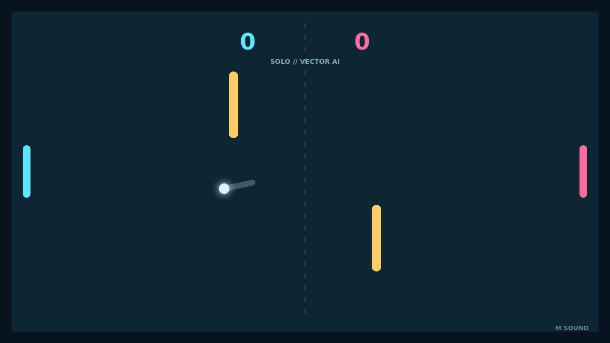

# Carom

Carom is a compact paddle duel where every rally becomes a little geometry
problem. Take the cyan paddle into a Solo match against the vector AI, or hand
the pink paddle to a friend for local Versus play.

The opening serve is quick, but the field changes once the ball reaches the
gold banks. A clean return can become a sharp angle, a delayed bank, or a route
that leaves the other paddle scrambling.

Paddle movement is part of every shot. Catch the ball while moving and it takes
on spin, bending its next flight into a curved, satisfying answer to the open
space between the obstacles.

